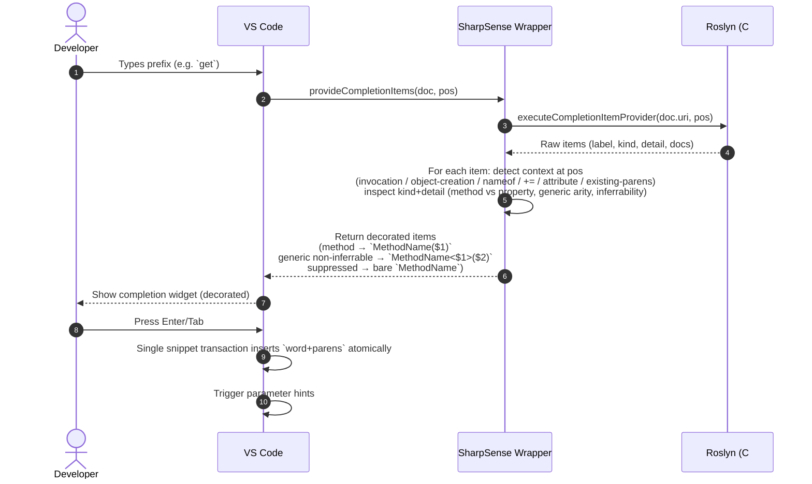

# SharpSense Architecture & Specification Document

> **Architectural pivot — 2026-09-13:** Phase 1 (Completion Engine) has moved from the legacy *post-accept change-listening* bridge to the **Provider-Wrapper** model. The diagram, sequence, and §1 below describe the current design. See `ROADMAP.md` Phase 1.2 for the migration plan. **v3 (same day):** the wrapper doubled every row (VS Code never dedupes across providers), so decoration moved to a commit shadow — Roslyn owns the only visible list and `acceptSelectedSuggestion` is shadowed. §1.0.2 describes the current design.

```
+-----------------------------------------------------------------------------------+
|                              SHARPSENSE ARCHITECTURE v2 — PROVIDER-WRAPPER        |
|                                                                                   |
|  +-----------------------------------+     +-----------------------------------+  |
|  |       Official Microsoft C#       |     |        C# Dev Kit                 |  |
|  |     (Roslyn Language Server)      |     |   (Solution/Workspace Services)   |  |
|  +-----------------+-----------------+     +-----------------+-----------------+  |
|                    |                                         |                    |
|                    +--------------------+--------------------+                    |
|                                         | (LSP / VS Code API)                     |
|                                         v                                         |
|  +-----------------------------------------------------------------------------+  |
|  |                         SharpSense Provider-Wrapper (Phase 1)                |  |
|  |  VS Code → `provideCompletionItems` → SharpSense calls                      |  |
|  |  `vscode.executeCompletionItemProvider` → gets Roslyn items → decorates     |  |
|  |  `insertText` as Snippet (`Foo($1)`, `List<$1>()`) → returns atomically     |  |
|  |                                                                             |  |
|  |  +----------------------------------+  +----------------------------------+ |  |
|  |  |   Subsystem 1: Completion Engine |  | Subsystem 2: Solution Explorer   | |  |
|  |  |  * Provider-Wrapper routing      |  |  * Dev Kit–backed TreeData      | |  |
|  |  |  * Smart Backspace & Postfix     |  |  * Dual SLN/SLNX + .csproj      | |  |
|  |  |  * Generics & context suppress   |  |  * Unity / Standard / File Views| |  |
|  |  +----------------------------------+  +----------------------------------+ |  |
|  +-----------------------------------------------------------------------------+  |
|                                                                                   |
|  Co-install pack (package.json → extensionPack, non-blocking):                   |
|    ms-dotnettools.csharp   — Roslyn LSP, completion source                      |
|    ms-dotnettools.csdevkit — workspace/solution services                        |
|  (extensionPack co-installs without blocking our activation;                    |
|   extensionDependencies was dropped — it delayed activation until C# loaded.)   |
+-----------------------------------------------------------------------------------+
```

---

## 1. ReSharper & Rider Completion Engine — Provider-Wrapper Mechanics

SharpSense **does not fork** the Roslyn Language Server and **does not listen to `onDidChangeTextDocument` to patch edits after the fact**. Instead it shadows the *commit* of the primary completion provider. Microsoft remains the single source of truth and the only visible list; we classify the just-committed word against Roslyn's own kinds and insert the paren suffix via `insertSnippet`.

### 1.0 Why the pivot

| Concern | Legacy (post-accept) | Provider-Wrapper (current) |
|---|---|---|
| Edit model | Word accepted by VS Code → SharpSense inserts `()` as **second** edit | Word+parens inserted as **one** native snippet edit |
| Undo | 2 VS Code stops + ghost re-parening on undo → 5× `Ctrl+Z`, `get` → `get()` corruption | 1 native stop → single `Ctrl+Z` removes word+parens together |
| Visual latency | 20 ms settle + async `executeCompletionItemProvider` **after** `Enter` → `foo` flashes before `()` | Classification happens **while the widget is open** (inside `provideCompletionItems`); `Enter` commits a pre-decorated snippet with zero extra IPC |
| Complexity | Change echo, many guards for output panels, batch `using` shifts, cache/warm, undo chaining | No echo, no output-panel filter, no settle, no cache — the document hasn't changed yet when we decide |

### 1.0.1 Sequence — Provider-Wrapper



Key guarantees:

- There is **no** post-accept edit. What you see in the widget is what you get on commit.
- SharpSense never re-ranks or hides Microsoft's items; it only rewrites `insertText` (to a `SnippetString`, which the editor auto-detects — the old `insertTextFormat` API was removed upstream) and converts Roslyn `textEdit`s to `range`+`insertText`. Sorting, filtering, and fuzzy matching stay native.
- If the wrapper returns `undefined`/fails, VS Code falls back to the underlying providers — vanilla behavior is preserved.

### 1.0.2 Shadow commit — one row per symbol (current design)

VS Code merges completion providers without deduping, so the v2 factory (a second provider returning decorated copies) doubled every row — unacceptable for the final product. There is no public API to modify or suppress another provider's rows, so SharpSense now contributes **zero** completion rows of its own and instead shadows the `acceptSelectedSuggestion` command:

1. User presses Enter/Tab with the widget open → our keybinding wins (extension bindings take precedence over the built-in when both match; ours adds `editorLangId == csharp` plus the `acceptSuggestOnEnter` / `editorTabCompletion` settings gates so user preferences are respected).
2. While the document still matches the open list, fetch Roslyn's items once into a label→kind map (one IPC per **commit**, zero per keystroke).
3. Call the built-in `acceptSelectedSuggestion` by its real id. It is never overridden: overriding replaces a command with no way back (the `default:` prefix alias exists only for the `type` command — calling `default:acceptSelectedSuggestion` throws "command not found" and breaks Enter).
4. Guard chain (all must pass or the commit stays bare): document actually changed; cursor on the same line; a word ends exactly at the cursor; the accept only **extended** the typed prefix (postfix templates and snippet commits fail this and are left alone); the word is in the map with a callable/type kind; line context allows call-site parens.
5. One `insertSnippet` per distinct suffix (`(${0})`, `<${1}>(${0})`, optional `;`) with `undoStopBefore/After: false`, then `triggerParameterHints`.

Fail-open everywhere: any miss or error leaves the default accept untouched. Known edges for F5: undo-stop merging and mouse/commit-character accepts (commit characters bypass the command and degrade gracefully — typing `(` still yields `(`).

### 1.1 Context-Aware Parentheses & Angle Bracket Routing

Applied **at commit** by the shadow (`registerCommitShadow`): one read-only `executeCompletionItemProvider` fetch while the widget is open, the default accept, then the SSCE two-variable function (Roslyn KIND × line-slice SLOT) and a single `insertSnippet` per distinct suffix. Nothing runs per keystroke. Slot mapping onto the line scan: Invocation → `invocation`, Declaration → `definition` / `unity-message-definition`, TypeInstantiation → `object-creation`, GenericTypeArgument → `invocation` inside unclosed `<...>`; attribute / `nameof` / `+=` / existing-parens / `other` stay bare as lexical suppressions. In code this is a zero-if strategy matrix: `resolveStrategyKey(kind, hasGenerics, isAfterNew, isDeclaration)` produces one composite key (`Callable:Generic`, `Type:Generic:Decl`, `Bare:PassThrough`, …) that is looked up in a `Record<string, Formatter>` — the rows below are the table entries, not branches:

- **R1 — generic callable** (`GetComponent` where Roslyn's label or `detail` reports `<T>`): `GetComponent<${1}>(${0})` with cursor inside `<>` first (Tab moves into `()`), unless every type parameter is inferrable from the parameter list (`isGenericInferrable` — `void Foo<T>(T x)` takes `()` only). Triggers parameter hints. Genericity is OR-ed across all same-name overload rows, so a non-generic top-ranked overload (e.g. `GetComponent(Type)`) no longer masks a generic sibling; kind still comes from the top row.
- **R2 — standard callable** (`DoSomething`): `DoSomething(${0})`, cursor between parens, triggers `editor.action.triggerParameterHints`. Construction (`new List`) takes the same call suffix (`new List<|>()` when Roslyn reports arity) but never a statement `;`.
- **R3 — generic type reference** (`List` in a declaration, cast, `is`, or generic-argument slot): `List<${1}>${0}` — angle brackets only, cursor inside, exit tabstop after `>`. No parens: a type reference is not a call. Non-generic types (`Console`, `DateTime`) stay bare. `public List|` is a field-type position (bare-modifier head + generic TYPE kind), not a ctor definition.
- **R4 — declaration guard** (`void Foo|`, `class Foo|`, `void Foo(DateTime|`, Unity stubs, `~Foo|`, overrides): always bare. A definition is not a call site.
- **R5 — pass-through** (keywords, properties, fields, variables, enums, namespaces, and anything with an unknown kind): always bare. Unknown means no guessing, ever.
- **C-guards**: C1 — a `(` ahead suppresses parens (never `Foo()()`); C2 — a `<` ahead suppresses `<>` (covers re-accepts and labels that carry their own `<T>`); the `;` terminator applies at statement end but never after `new`.

Genericity comes exclusively from Roslyn metadata (`parseGenericArity` over label/detail + `isGenericInferrable`) — no keyword lists anywhere on the kind axis. The modifier/type-definition patterns in `src/context.ts` serve the slot axis only (R4), which Roslyn's kind cannot express (a definition and its call site share the same kind).

All predicates are the same pure, line-local regex scans in `src/context.ts` as before — they just run **after** the default accept instead of before insertion, which also lets the locate step tolerate line shifts from auto-`using` inserts (unimported namespaces still decorate).

### 1.2 Smart Backspace & Bracket Lifecycle — Synchronous Redesign

Legacy design rested on `pairBackspaceAvailable` driven by `onDidChangeTextDocument`. Live testing showed it failing to track the pair when the cursor sits between `(|)` (stale document listener, missed selection moves).

**Redesigned contract:**

- **Context key driver:** `vscode.window.onDidChangeTextEditorSelection` — the *selection* event fires on every cursor move, click, and snippet jump. It is the only reliable source for "cursor is between an empty pair". On each event (and on `onDidChangeTextDocument` where the active doc matches) SharpSense recomputes:

  ```ts
  pair = smartBackspace
      && every selection isEmpty
      && every pos: isEmptyPair(doc, pos)  // PAIRS[before] === after for () <> [] {} "" ''
  ```

  and calls `setContext('sharpsense.pairBackspaceAvailable', pair)` **only on change** (avoids IPC spam).

- **Keybinding** (`package.json`):

  ```json
  { "command": "sharpsense.deletePair", "key": "backspace",
    "when": "editorTextFocus && editorLangId == csharp && sharpsense.pairBackspaceAvailable && !suggestWidgetVisible" }
  ```

  `!suggestWidgetVisible` ensures the widget, not the pair, owns Backspace when open. `editorLangId == csharp` keeps the binding out of other languages.

- **Command handler (`src/brackets.ts:doDeletePair`):** Single atomic transaction

  ```ts
  await ed.edit(b => {
    for (const sel of ed.selections)
      if (sel.isEmpty && isEmptyPair(doc, sel.active))
        b.delete(new Range(sel.active.translate(0,-1), sel.active.translate(0,1)));
  });
  ```

  Both characters (`(` and `)`) are deleted in **one** `WorkspaceEdit`, so the operation itself is a single undo stop. No fallthrough deletes a single char.

*Other bracket features (§1.2–1.3 of the legacy spec — structural Tab-out, overtype `)`/`>`, smart `;`) keep their existing `when`-clause `setContext` design and `type` interceptor; only the pair-delete driver is redesigned.*

### 1.3 Smart Enter

`sharpsense.smartEnter` (bound to Enter via `package.json` when `!suggestWidgetVisible && !inSnippetMode`). Implemented in `src/commands/smartEnter.ts` via `trySmartEnter`. Four sections, evaluated in order:

1. **`{|}` brace expansion** — collapses empty brace pair into a multi-line block (K&R: `{` stays on header line; Allman: `{` on its own line). Single `ed.edit` → single undo restores `{}`.
2. **Method header brace expansion** — `void Foo()|` → inserts brace block per `braceStyle` (Option B: skips if `{` already present, just indents). **Excludes control-flow keywords** (`for`, `while`, `if`, etc.) so they don't match the `Foo()` bare-constructor pattern.
3. **Control-flow header newline** — `for (...)|` → newline + 1 tab stop indentation only, **no brace inserted** (deferred to when user types `{`). `isControlHeader` detects by keyword (`if`/`else`/`for`/`foreach`/`while`/`do`/`switch`/`lock`/`using`) + balanced parens + no existing braces. When `{` is already at end of header, just opens a new indented line.
4. **Semicolon insertion** — unclosed statement → appends `;` then newline, cursor indented.

### 1.4 Smart Brace Surround

When `{` is typed with a selection, `trySmartBraceSurroundSelection` (`src/commands/smartBraceSurround.ts`) wraps the selection in a brace block:

- **K&R:** opening brace appended to parent control-flow header line (`for (...) {`), statement indented +1 tab stop inside, closing `}` aligned with header.
- **Allman:** `{` placed on line after header, aligned with header indentation, statement +1 tab stop, `}` aligned.
- **No parent header:** brace block inserted at selection's indentation level.
- When `{` is typed on a statement line below an unbraced header (no selection), `trySmartBraceSurround` merges the block to the parent header instead of creating an orphan block. Typing `{` directly on a header line defers to native `{}` insertion (Smart Enter handles full expansion on next Enter).

### 1.5 Postfix Templates & Live Template Expansion

Unchanged in shape — own `CompletionItemProvider` triggered by `.`, with `extractPostfixTarget` depth-counting. Lives alongside the wrapper provider; no interaction. Trigger map:

| Postfix | Expanded C# |
|---|---|
| `.var` | `var name = expr;` |
| `.if` / `.else` | `if (expr) {` |
| `.null` / `.notnull` | `if (expr == null) {` |
| `.for` / `.foreach` | `foreach (var item in collection) {` |
| `.return` | `return expr;` |
| `.using` | `using var scope = expr;` |
| `.await` | `await expr;` |
| `.try` | `try { expr; } catch (Exception e) {` |
| `.throw` | `throw expr;` |
| `.cast` / `.as` | `((TargetType)expr)` / `(expr as TargetType)` |
| `.switch` | `switch (expr) { ... }` with all enum members |

Brace style honored via `sharpsense.braceStyle` (`allman` / `k&r` / `inherit`) through `resolveBraceStyle` + `cachedBraceStyle`.

### 1.4 Commit Keys & IntelliSense Behavior

Enter/Tab are now **native** snippet commits (the wrapper's `SnippetString` is committed directly). SharpSense no longer registers `sharpsense.acceptEnter`/`sharpsense.acceptTab` interceptors — removal is intentional, it was the source of post-accept edits.

- **Enter** — commits decorated snippet.
- **Tab** — same snippet; `!inSnippetMode` guard preserved on Tab wrapper only where needed.
- **`;`** — still handled by the global `type` interceptor (`Foo(|)` + `;` → `Foo();`), unchanged.
- **Sorting** — SharpSense does not re-sort; relevance remains Roslyn's. Postfix templates have their own `sortText` within the `.`-triggered list.

### 1.5 Brace Style Preference (Allman / K&R)

`sharpsense.braceStyle` with values `allman`, `k&r`, `inherit` (follows `.editorconfig`/`csharp_new_line_before_open_brace` via file scan). Applies to every block the wrapper or postfix inserts. Never reformats unrelated code.

---

## 2. Visual Studio 2026 Solution Explorer Features

*Unchanged — retained verbatim for reference. Phase 2 will back this tree with **C# Dev Kit** APIs (see ROADMAP Phase 2).*

SharpSense replicates all core UI and structural capabilities of the Visual Studio 2026 Solution Explorer.

```
┌─────────────────────────────────────────────────────────────┐
│ SOLUTION EXPLORER                                    🧱 ⚙️ 🔍│
├─────────────────────────────────────────────────────────────┤
│ 📄 Solution 'MyGameSystem' (3 of 3 Projects)                │
│  ├── 📁 01_Core                                             │
│  │    └── 📦 MyGame.Core (.NET 10.0)                        │
│  │         ├── 📦 Dependencies                              │
│  │         │    ├── 📄 Analyzers                            │
│  │         │    ├── 📦 Frameworks (Microsoft.NETCore.App)   │
│  │         │    ├── 📦 NuGet (Newtonsoft.Json 13.0.3) ⚠️     │
│  │         │    └── 🔗 Projects (MyGame.Shared)             │
│  │         ├── 📄 Program.cs                                │
│  │         │    ├── 🔷 class Program                        │
│  │         │    └── 🔹 void Main(string[] args)             │
│  │         └── 📄 GameEngine.cs                             │
│  │              └── 🔷 class GameEngine                     │
│  └── 📁 02_Unity                                            │
│       └── 🎮 MyGame.Unity (Unity 2026.1)                    │
│            ├── 📦 Packages (Embedded & Manifest)            │
│            └── 📂 Assets                                    │
│                 └── 📂 Scripts                              │
│                      └── 📄 PlayerController.cs             │
└─────────────────────────────────────────────────────────────┘
```

### 2.1 View Modes & Filtering

Standard hierarchy rendering `.sln` and `.slnx`, solution folders, project refs; Show All Files overlay; fuzzy search; Pending Changes (Git); hide/show symbols under `.cs` files.

### 2.2 Dependency & Reference Management

NuGet (version + transitive + Copilot/audit vulnerability flags), `<ProjectReference>` add/remove, `<Reference>` DLL, COM/`.projitems`, analyzers/generators.

### 2.3 Project & Item Lifecycle

Template picker, Add Existing (copy vs. link), safe rename, `DependentUpon` nesting.

### 2.4 Project Configuration

Property pages GUI (TFM, output type, nullable, implicit usings, lang version), side-by-side `.csproj` XML, Debug/Release & platform switcher.

---

## 3. JetBrains Rider Solution Explorer Features

Namespace-aware move, folder/project rename, safe delete, `Directory.Packages.props`/`Directory.Build.props` nodes — retained as-is; surfaced through the Dev Kit workspace model in Phase 2.

---

## 4. Unity-Specific Solution Explorer View & Dynamic Switching

*(Retained verbatim; activation now optional — only when `visualstudiocode-unity.unity` is installed, see ROADMAP § Phase 2.6/3.)*

Automatic detection via `Assets/` + `ProjectSettings/` + `Packages/manifest.json`; 3-way toolbar (Unity / Standard Solution / File System); `.asmdef`/`.asmref` first-class nodes + reference editor; synchronized `.meta` handling; Unity scaffolding menus; `.NET` template table (§5).

---

## 5. C# Project Templates Reference Table (VS 2026 & .NET SDK)

*Retained verbatim — referenced by Phase 2 scaffolding and Phase 3 Unity templates.*
